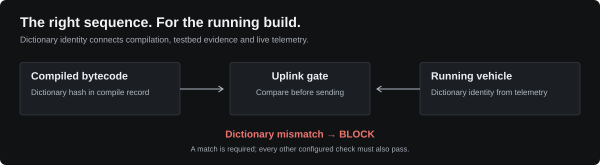

# Uplink Gate



## Inspiration

This started with a practical question: **what if a sequence is valid, but was compiled for the wrong version of the spacecraft software?**

[F Prime](https://github.com/nasa/fprime) is a flight software framework, and [Fpy](https://github.com/fprime-community/fpy) is its sequencing language. Each flight software build produces a **dictionary** describing command IDs and argument types. The ground compiler uses that dictionary to turn a sequence into the bytes the vehicle executes.

A concrete example of why those definitions matter is [fprime-gds PR #358](https://github.com/fprime-community/fprime-gds/pull/358). It fixed a parameter-writing tool that used a fixed string-length width instead of the width declared by the dictionary. Ground software could produce data that the flight software could not read.

That inspired the central idea here: carry the dictionary identity from compilation all the way to the upload decision. JPL’s [FRESH](https://github.com/NASA-JPL-Teamtools-Studio/tts_fresh) also inspired the flight rule checks.

## The problem: a gap in the public workflow

In the Fpy version used here, **compiled bytecode contains no dictionary or build identity**. Its header records compiler and format versions, and a checksum detects damaged bytes. Neither establishes that the file matches the software currently running on the target. See the [Fpy v0.6.0 bytecode implementation](https://github.com/fprime-community/fpy/blob/v0.6.0/src/fpy/bytecode/assembler.py).

This project reproduces the problem with two real builds of F Prime’s reference deployment. One command argument changes from a 32-bit integer to a 16-bit integer. Without the gate, mismatched bytecode starts executing, then stops at that command with `FORMAT_ERROR`. Earlier statements have already run.

The missing link is between **the dictionary used to compile**, **the exact bytes tested**, and **the build the target reports now**. I have not identified a public F Prime/Fpy implementation of this complete gate in the sources reviewed. That is a scoped observation, not a claim that private mission systems lack equivalent checks.

## Solution

Uplink Gate records the dictionary hash alongside every compiled file, reads the vehicle’s identity from telemetry, and blocks uploads when they disagree. It asks for a fresh identity and repeats the checks immediately before sending.

The contribution is connecting those facts into one enforced upload path:

- **Compilation has provenance.** Each compile record binds the source, bytecode and dictionary using SHA-256 hashes.
- **The target is identified live.** The demo flight software reports a dictionary hash prefix through telemetry. Version labels alone are insufficient: while building the demo, an incremental build retained the previous build’s version label despite a changed dictionary.
- **Testbed evidence is specific.** A successful run counts only for the same bytecode and the same dictionary the target is running. After a build swap, evidence for the old dictionary no longer qualifies the new one.

Hashing, flight rule checking and simulation already exist. The distinctive work here is their integration around dictionary identity and live vehicle state, demonstrated against running F Prime software.

The gate evaluates four checks:

| Check | What it establishes |
|---|---|
| Build match | The bytecode was compiled with the target’s dictionary. |
| Testbed equivalence | These bytes ran successfully on a testbed with that dictionary. |
| Flight rules | The sequence satisfies the configured command and timing rules. |
| Simulation | A small model, starting from telemetry, predicts no configured state violation. |

The demo includes three vehicle processes and a 3D console. Change a vehicle’s build while the system runs, and the same bytecode changes from PASS to BLOCK.

## How to run it

Install Docker, then start the stack from the repository root:

```sh
docker compose up --build -d
```

Open [localhost:8000](http://localhost:8000). The first start compiles F Prime twice; once the services start, allow about 15 seconds for telemetry. If `.env` sets `GATE_PORT=8088`, use [localhost:8088](http://localhost:8088) instead.

1. Select `signal_setup` and compile it for the vehicles you tick.
2. Select `testbed` and click **Check and uplink** on its matching bytecode. A successful run creates testbed evidence.
3. Select `sc1` and use **Check and uplink** on those same bytes. Both vehicles initially run build A.
4. Change `sc1` to build B and try the old bytecode again:

```sh
./scripts/reflash.sh sc1 B
```

After fresh telemetry arrives, the build-match check blocks it. Switch back with `./scripts/reflash.sh sc1 A`.

`signal_setup` toggles the signal generator on. Running it again can be blocked by the simulation check because the generator is already running. The full walkthrough is in [docs/demo.md](docs/demo.md).

Stop the stack with `docker compose down`. Add `-v` only to delete its stored data too.

### Technical details

- **Gate:** Python library, CLI and FastAPI service. Compiles run in separate worker processes; REST and WebSocket endpoints serve the UI.
- **Vehicles:** Docker containers running patched F Prime `Ref` builds and `fprime-gds`. `testbed` and `sc1` start on build A; `sc2` starts on build B.
- **Storage:** PostgreSQL for compile records, decisions and testbed runs; InfluxDB and Grafana for telemetry. The CLI uses SQLite by default.
- **UI:** React, TypeScript and react-three-fiber. Orbits are illustrative, not mission ephemerides.
- **Public hosting:** The UI can run on Vercel while `scripts/publish.sh` connects it to the local Docker stack through a Cloudflare tunnel. The backend machine must remain running. `GATE_WRITE_TOKEN` enables a password for actions.

For local development and checks:

```sh
uv sync --all-extras
./scripts/check.sh
(cd web && npm ci && npm test)
GATE_API_URL=http://localhost:8000 uv run pytest -m integration
```

The integration tests require the Docker stack. Use its configured port in `GATE_API_URL`.

This is a portfolio prototype, not flight-qualified software. Its simulation is deliberately small, and compile records are not cryptographically signed. More detail: [design and limits](docs/design.md), [vehicle build instructions](vehicles/README.md), [flight rules](rules/demo_rules.yaml), and [simulation model](rules/demo_model.yaml).

Licensed under [Apache-2.0](LICENSE). F Prime and Fpy have their own licenses.
